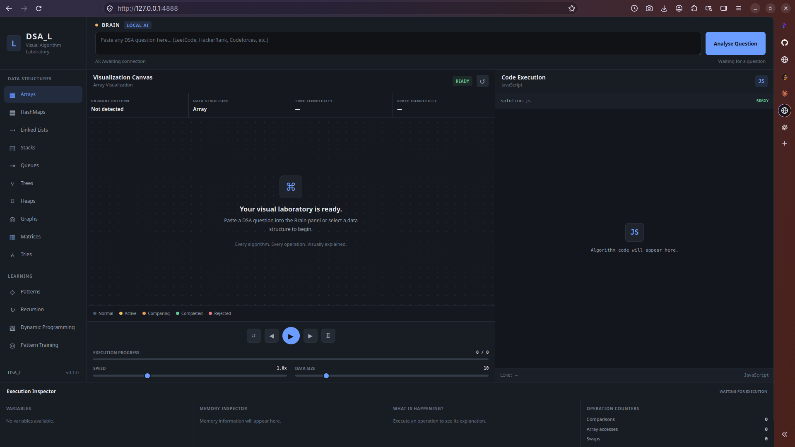

# DSA_L — Interactive Data Structures & Algorithms Learning Laboratory

<p align="center">
  <strong>A visual-first environment for understanding, exploring, and debugging Data Structures and Algorithms.</strong>
</p>

<p align="center">
  <em>Understand algorithms by watching them execute, one operation at a time.</em>
</p>

---

## Overview

**DSA_L** is an interactive Data Structures and Algorithms learning laboratory designed to make algorithmic concepts easier to understand through visualization, execution tracing, and synchronized JavaScript code.

Traditional DSA learning often involves reading theoretical explanations, examining static code examples, and mentally tracing algorithm execution. DSA_L aims to make that learning process more visual, interactive, and intuitive.

The application is being developed around one central idea:

> Instead of simply showing the final answer to an algorithmic problem, show the learner exactly how the algorithm reaches that answer.

Users will eventually be able to provide algorithmic questions from platforms such as LeetCode, HackerRank, Codeforces, GeeksforGeeks, or their own problem statements. The application will interpret the problem, identify relevant algorithmic patterns, and connect it to a supported algorithm implementation.

The algorithm will then execute through a deterministic visualization engine, allowing users to inspect its operations and understand its behavior step by step.

DSA_L is being built using **HTML, CSS, and Vanilla JavaScript**, with no frontend framework or application backend.

---

## Application Preview

### Current Application Interface



*The initial application workspace. The screenshot will be updated as the interface and functionality evolve.*

---

## Project Goals

The long-term objective is to create a comprehensive visual learning environment covering the most important Data Structures and Algorithms concepts.

Key objectives include:

- Visualize data structures and algorithm execution.
- Make algorithmic patterns easier to recognize.
- Connect every meaningful execution step to its corresponding JavaScript code.
- Provide forward and backward execution controls.
- Display variables, memory representations, and operation explanations.
- Track algorithm operations and complexity-related metrics.
- Support a growing library of trusted algorithm implementations.
- Integrate a locally running AI model to assist with problem interpretation.
- Maintain a lightweight, responsive, and portable application.

---

## Core Features

The following sections distinguish between functionality already implemented and functionality planned for future development.

### Implemented

| Feature | Description | Status |
|---|---|---|
| Application workspace | Three-panel application layout | Implemented |
| Brain/question input | Interface for entering algorithmic problems | UI implemented |
| DSA navigation | Navigation for major data structures | UI implemented |
| Visualization canvas | Dedicated area for algorithm visualizations | UI implemented |
| JavaScript code panel | Dedicated panel for displaying algorithm code | UI implemented |
| Execution controls | Play, pause, next, previous, and restart controls | UI implemented; execution integration pending |
| Speed control | Execution speed slider | UI implemented |
| Data size control | Visualization data-size slider | UI implemented |
| Execution inspector | Variables, memory, operation explanation, and metrics panels | UI implemented; live data integration pending |
| Dark/light theme foundation | Theme design tokens and theme initialization | Initial implementation |
| State Recorder | Records execution steps as independent state snapshots | Implemented and manually tested |

### Planned

| Feature | Description | Status |
|---|---|---|
| Algorithm execution engine | Coordinates algorithm execution and recorded steps | In development |
| Complexity counter | Tracks comparisons, accesses, swaps, assignments, and other operations | Planned |
| Execution player | Controls playback, navigation, speed, and restart | Planned |
| Bubble Sort visualizer | First complete algorithm visualization | Planned |
| Synchronized code execution | Highlights the currently executing JavaScript line | Planned |
| Dynamic data structure rendering | Visualizes arrays, linked lists, trees, graphs, stacks, queues, and more | Planned |
| AI problem interpretation | Identifies patterns, structures, and possible algorithms | Planned |
| Ollama integration | Connects to a locally running language model | Planned |
| Algorithm library | Growing collection of trusted JavaScript implementations | Planned |
| Test suite | Validates algorithm execution and visualization behavior | Planned |

---

## Application Interface

The application is organized around a visual-first three-panel workspace.

### 1. DSA Navigation Sidebar

The left sidebar provides access to different data structures and learning categories.

Planned categories include:

- Arrays
- Hash Maps
- Linked Lists
- Stacks
- Queues
- Trees
- Heaps
- Graphs
- Matrices
- Tries
- Recursion
- Dynamic Programming
- Algorithmic Patterns
- Training

### 2. Visualization Workspace

The central workspace is dedicated to rendering the actual execution of an algorithm.

Depending on the selected algorithm, this area will display relevant structures and their changing states.

Examples include:

- Array elements and indexes.
- Hash table buckets and collisions.
- Linked list nodes and pointers.
- Stack and queue operations.
- Tree nodes and relationships.
- Graph vertices and edges.
- Matrix coordinates.
- Dynamic programming tables.
- Recursion trees.

Visualizations will use lightweight animations to communicate algorithm operations without overwhelming the learner.

### 3. JavaScript Code Panel

The right panel is designed to be a first-class part of the learning experience.

It will display the actual JavaScript implementation corresponding to the active visualization.

Planned capabilities include:

- Current execution line highlighting.
- Previously executed lines.
- Upcoming lines.
- Variable inspection.
- Execution explanations.
- Synchronization between code and visualization.

The objective is to let learners see the relationship between source code and the resulting changes in a data structure.

### 4. Execution Inspector

The bottom inspector provides additional information about the current execution step.

It is designed to display:

- Variables and their current values.
- Illustrative memory representations.
- Current operation details.
- Algorithm execution metrics.
- Comparison counts.
- Array access counts.
- Swap counts.
- Assignment counts.

Memory addresses displayed in visualizations will be illustrative representations, not actual JavaScript runtime memory addresses.

### 5. Execution Controls

The application includes a dedicated execution control area.

Planned behavior:

| Control | Purpose |
|---|---|
| Play | Start or resume execution |
| Pause | Pause execution |
| Next | Move to the next recorded step |
| Previous | Return to the previous recorded step |
| Restart | Return to the initial execution state |
| Speed | Adjust animation playback speed |
| Data Size | Adjust the amount of visualization data |

---

## Architecture

DSA_L follows a modular, browser-native architecture.

The application separates algorithm implementations, execution management, state recording, visualization, and user interface responsibilities.

```text
DSA_L
│
├── index.html
│
├── css/
│   ├── theme.css
│   ├── base.css
│   ├── layout.css
│   ├── animations.css
│   └── components/
│
├── js/
│   ├── app.js
│   │
│   ├── ai/
│   │
│   ├── algorithms/
│   │
│   ├── core/
│   │   ├── state-recorder.js
│   │   ├── engine.js
│   │   ├── execution-player.js
│   │   └── complexity-counter.js
│   │
│   ├── debugger/
│   │
│   ├── structures/
│   │
│   ├── utils/
│   │
│   └── visualizers/
│
├── docs/
│   ├── screenshots/
│   ├── ALGORITHMS.md
│   ├── ARCHITECTURE.md
│   └── ROADMAP.md
│
├── tests/
│
├── README.md
└── .gitignore
```

The architecture is intentionally modular so that new algorithms, data structures, and visualizers can be added without making the application dependent on a single large JavaScript file.

### Execution Architecture

A central design decision is that AI interpretation and algorithm execution are separate responsibilities.

The intended execution flow is:

```text
          User Problem
                |
                v
        Problem Interpretation
                |
                v
       Algorithm / Pattern Mapping
                |
                v
       Trusted Algorithm Library
                |
                v
        Deterministic Execution
                |
                v
          State Recorder
                |
                v
          Execution Engine
                |
                v
       Visualization + Code Panel
                |
                v
          Execution Inspector
```

AI will assist with understanding the problem and selecting an appropriate supported implementation.

It will not directly manipulate visualization animations or execute arbitrary generated code.

This separation is intended to make algorithm execution predictable, testable, and reproducible.

---

## State Recording and Time-Travel Execution

One of the foundational components already implemented is the **State Recorder**.

File:

```text
js/core/state-recorder.js
```

The State Recorder captures independent snapshots of algorithm execution.

Each recorded step contains:

- A unique step identifier.
- The operation being performed.
- The current data structure state.
- The corresponding source code line.
- Current variable values.
- A human-readable explanation.
- Execution metrics.
- Additional metadata.

Example execution step:

```javascript
{
    action: "SWAP",

    state: {
        array: [3, 5, 8, 2]
    },

    codeLine: 5,

    variables: {
        i: 0,
        j: 0
    },

    explanation: "Swapped 5 and 3.",

    metrics: {
        comparisons: 1,
        swaps: 1
    }
}
```

### Why snapshots?

Instead of trying to reverse CSS animations or manually undo every operation, DSA_L uses recorded logical states.

This makes it possible to:

- Move forward through execution.
- Return to previous execution steps.
- Restart an algorithm.
- Jump to a particular recorded step.
- Re-render the visualization from a known state.

Every snapshot is independently cloned, preventing later mutations from corrupting previously recorded states.

The State Recorder has been manually tested in the browser.

---

## Technology Stack

| Technology | Purpose |
|---|---|
| HTML5 | Application structure |
| CSS3 | Layout, styling, themes, and animations |
| Vanilla JavaScript | Application logic and algorithm implementations |
| JavaScript ES Modules | Modular application architecture |
| Browser APIs | DOM manipulation and execution controls |
| http-server | Local static development server |
| Ollama | Planned local AI model integration |
| Git | Version control |
| GitHub | Source code hosting and project documentation |

### Important Design Decisions

- No React, Angular, or Vue.
- No application backend.
- No database.
- No authentication system.
- No dependency on a cloud AI service for core visualization functionality.
- The core application should remain usable without AI integration.
- Local AI integration will be optional.

The project is intended to remain lightweight and portable.

---

## Local Development

### Requirements

- A modern web browser.
- Node.js and npm, for installing and running the static development server.
- Git.

Node.js is used only for development tooling. DSA_L does not require a Node.js application backend.

### Clone the Repository

```bash
git clone <YOUR_GITHUB_REPOSITORY_URL>
```

### Navigate to the Project

```bash
cd dsa_l
```

### Start the Development Server

```bash
http-server -p 4888
```

Open the following address in your browser:

```text
http://localhost:4888
```

The application is served as a static website.

---

## Local AI Integration

AI-assisted problem interpretation is part of the long-term architecture.

The planned integration uses Ollama to communicate with a locally running language model.

The current local model being evaluated is:

```text
qwen2.5-coder:7b
```

The intended workflow is:

1. The user submits a DSA problem.
2. The model analyzes the problem statement.
3. It identifies likely algorithmic patterns and data structures.
4. It suggests a supported algorithm implementation.
5. The application validates the mapping.
6. The trusted JavaScript implementation generates execution steps.
7. The visualization engine renders those steps.

AI integration is not yet implemented.

The application will retain manual visualization functionality even when Ollama is unavailable.

---

## Development Roadmap

Development is being organized into milestones.

| Milestone | Objective | Status |
|---|---|---|
| M1 | Project foundation and application workspace | Completed |
| M2 | Execution architecture and state management | In progress |
| M3 | First complete algorithm implementation | Planned |
| M4 | Array visualization and synchronized code panel | Planned |
| M5 | Execution inspector and complexity metrics | Planned |
| M6 | Additional data structure visualizers | Planned |
| M7 | Algorithm pattern recognition | Planned |
| M8 | Ollama integration | Planned |
| M9 | Testing, optimization, and documentation | Planned |
| M10 | Public release and portfolio presentation | Planned |

### Immediate Development Priorities

The next implementation steps are:

1. Implement the Complexity Counter.
2. Implement the Execution Engine.
3. Implement the Execution Player.
4. Develop Bubble Sort as the first complete algorithm.
5. Connect algorithm execution to the State Recorder.
6. Render array states in the visualization canvas.
7. Synchronize the JavaScript code panel with execution.
8. Display live metrics and variables in the inspector.

---

## Screenshots

Screenshots will be maintained in:

```text
docs/screenshots/
```

As new capabilities are implemented, screenshots will be added to document the actual state of the application.

| Screenshot | Description |
|---|---|
| `app-overview.png` | Main application workspace |
| `array-visualization.png` | Array visualization |
| `code-execution.png` | Synchronized JavaScript execution |
| `execution-inspector.png` | Variables, operations, and complexity metrics |

Screenshots will be updated as the application evolves.

---

## Engineering Principles

DSA_L is being developed around the following principles:

**1. Visual-first learning**

The application should explain algorithms through visible operations, not just textual descriptions.

**2. Deterministic execution**

Algorithm execution should produce predictable, reproducible state transitions.

**3. Separation of concerns**

Problem interpretation, algorithm execution, state recording, visualization, and UI rendering should remain separate modules.

**4. Trusted implementations**

Visualizations should be driven by tested JavaScript implementations rather than arbitrary AI-generated executable code.

**5. Reversible execution**

Previous and next controls should operate on recorded logical states.

**6. Lightweight design**

The application should avoid unnecessary frameworks, services, and dependencies.

**7. Progressive development**

New algorithms and visualizers should be introduced incrementally, with testing and documentation at every milestone.

---

## Project Status

DSA_L is currently in its foundational development stage.

The initial application workspace, styling system, navigation structure, visualization canvas, JavaScript code panel, execution controls, and execution inspector have been established.

The first core execution component, the State Recorder, has also been implemented and manually tested.

The immediate focus is building the execution architecture and connecting it to a real algorithm visualization.

**This project is actively under development.**

---

## Contributing

The project is currently being developed incrementally.

As the architecture stabilizes, contribution guidelines and instructions for adding new algorithm implementations and visualizers will be documented.

---

## License

License information will be added before the first public release.